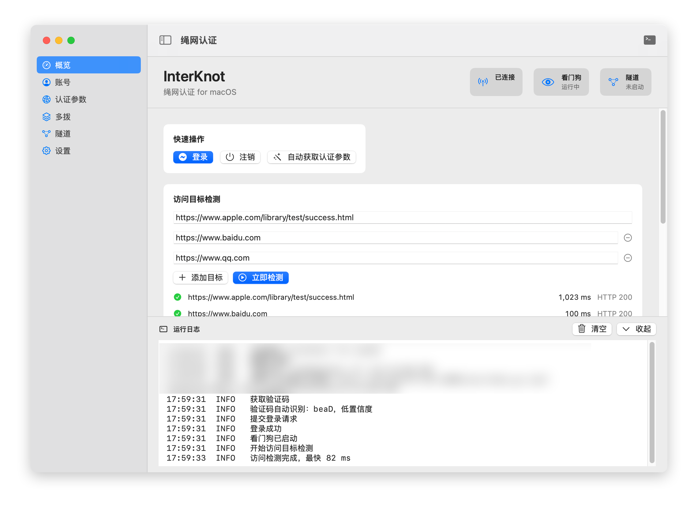
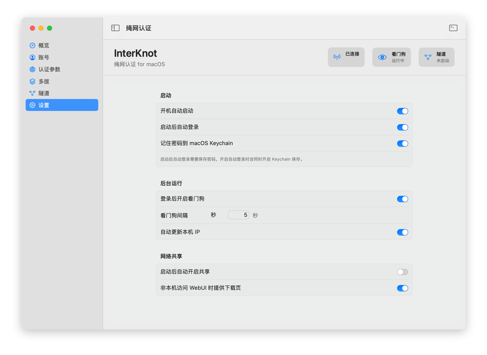

# InterKnot Auth for macOS

InterKnot Auth for macOS 是广东天翼校园网认证工具的 macOS 原生适配版，使用 SwiftUI 和系统原生组件重做界面与交互。

本项目功能参考并迁移自原项目：

- 原项目：[Yish1/InterKnot_Auth](https://github.com/Yish1/InterKnot_Auth)
- 协议/流程参考：[Pandaft/ESurfingPy-CLI](https://github.com/Pandaft/ESurfingPy-CLI)

## 功能

- 广东天翼校园网登录与下线
- 自动获取或手动解析认证参数
- 本地自动识别并提交登录验证码，失败时回退到手动输入
- 登录后访问目标检测与延迟显示
- 看门狗检测与自动重连
- 开机自动启动与启动后自动登录
- macOS 菜单栏常驻入口，不占用 Dock
- 多拨配置
- EasyTier 隧道配置
- 全局可展开运行日志
- 配置自动保存，密码可保存到 macOS Keychain

## 界面预览





## 认证流程

1. 填写账号、密码和认证参数。
2. 点击登录后获取认证页和验证码。
3. 本地识别验证码并自动提交；识别失败或网关返回验证码错误时，弹窗手动输入。
4. 保存网关返回的 `signature`，随即验证外网连通性；验证通过后才显示“已连接”并启动看门狗。验证失败时仍可用当前会话信息尝试注销。
5. 点击注销时使用当前 `signature` 请求 `/ajax/logout` 下线。

如果不是通过本应用登录，应用通常拿不到当前会话的 `signature`，因此无法代替网页或官方客户端下线。

外网检测使用 HTTP 连通性请求，所有目标并发执行，整轮最多约 5 秒；登录验证任一目标通过即结束。每个目标的结果立即写入运行日志。默认检测点会检查预期状态码或响应内容，拒绝把认证页跳转当作联网成功。

## 认证参数

自动获取认证参数需要连接校园网络。获取请求绕过系统 HTTP 代理（VPN/TUN 仍可能影响路由），并发读取认证跳转，整轮最多约 5 秒；获取失败会明确报错，不会用普通网卡 IP 冒充认证 IP。

如果自动获取失败，可以在浏览器访问 `2.2.2.2`，复制跳转后的完整地址，在应用的“账号”页点击“手动解析”后粘贴解析。

## 构建

```sh
swift build
swift test
make bundle
```

打包后的应用位于：

```text
InterKnotAuth.app
```

如果应用已经打开，重新打包后需要退出旧进程再重新打开，运行中的 App 不会自动替换成新版本。
